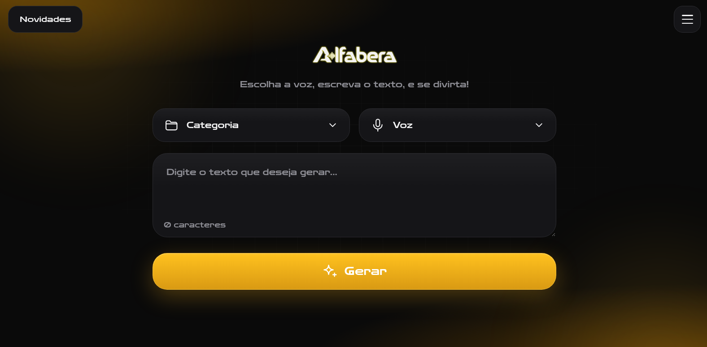
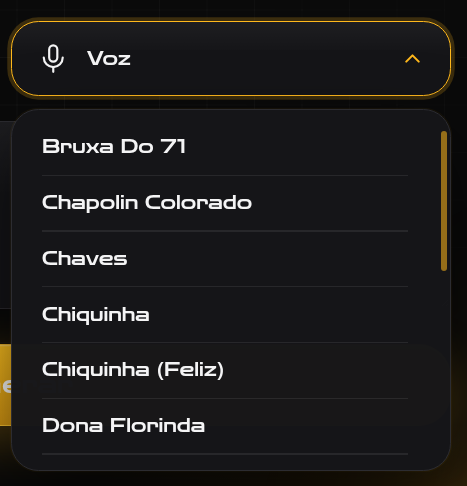

# Alfabera

**Texto para voz (TTS) em português do Brasil, direto no navegador.**

[🌐 Acessar o site - Alfabera.netlify.app](https://alfabera.netlify.app)

<!--
PALAVRAS-CHAVE (chaves):
alfabera, alfabera tts, tts, text to speech, texto para voz, texto em voz, conversor de texto em áudio,
texto para fala, gerador de voz, gerador de voz online, voz com inteligência artificial,
voz IA, voz IA brasileira, tts brasileiro, tts português, tts pt-br, vozes brasileiras,
vozes de famosos, vozes de famosos brasileiros, voz de famosos IA, narrador online,
narração de texto, narração de vídeo, locução online, locutor virtual, voz para TikTok,
voz para YouTube, voz para Reels, voz para Shorts, voz para dublagem, síntese de voz,
speech synthesis, voice generator, brazilian portuguese tts, ai voice generator, free tts
-->

---

## Sobre

O **Alfabera.netlify.app** é um site de **texto para voz (TTS) em português do Brasil**. Você escolhe uma voz, escreve ou cola um texto e ouve o resultado em segundos. O grande diferencial é o catálogo com **diversas vozes de famosos brasileiros**, para dar vida ao seu texto com vozes que o público já conhece. Tudo funciona direto no navegador, sem instalar nada e sem precisar de conhecimento técnico.

Ideal para narração de vídeos, conteúdo para redes sociais, apresentações, brincadeiras e muito mais.

## Funcionalidades

- 🌟 **Vozes de famosos brasileiros**: um catálogo variado de vozes conhecidas do público
- 🎙️ **Várias vozes**: escolha a voz que combina com o seu texto
- 🗂️ **Vozes organizadas por categoria**: fica fácil encontrar o estilo certo
- 🛡️ **Moderação de conteúdo**: textos inadequados são bloqueados, para manter o uso seguro
- 📰 **Novidades**: uma seção para acompanhar as atualizações do site
- 🔔 **Avisos na tela**: comunicados importantes aparecem em destaque, com um botão "Entendi"
- 📱 **Para computador e celular**: layout que se adapta a qualquer tela

## Site - Alfabera.netlify.app

<!-- Quando tiver os prints, envie para a pasta "imagens" e tire os comentários abaixo.
     Dica de SEO: use textos descritivos no alt, como "Alfabera - tela de escolha de vozes de famosos brasileiros" -->

<!--

-->
